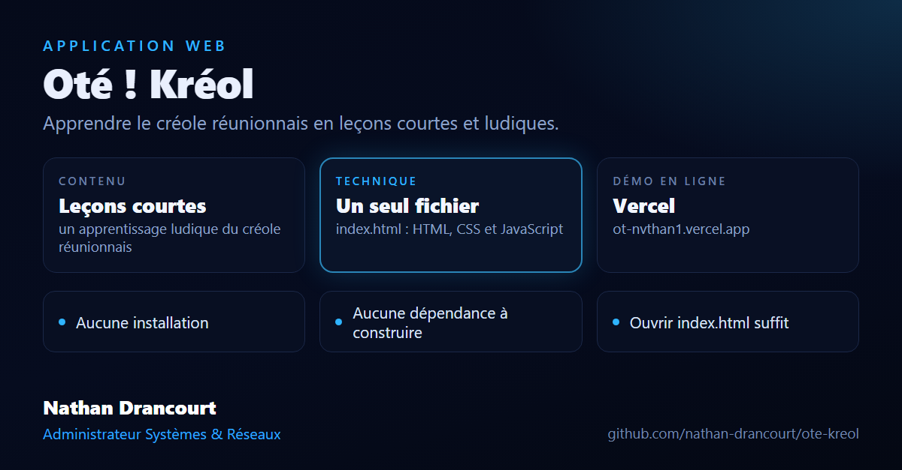

# Oté ! Kréol

Application web pour apprendre le créole réunionnais, en leçons courtes et ludiques.

**Démo** : https://ot-nvthan1.vercel.app

## Contenu

Le projet tient dans un seul fichier, `index.html` (HTML, CSS et JavaScript), sans installation ni dépendance à construire.

## Lancer en local

Ouvrir `index.html` dans un navigateur.
